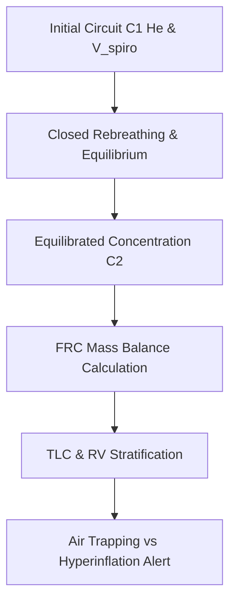

# Pulmonary Closed-Circuit Helium Dilution FRC Personal Agent Skill

[](LICENSE)
[](https://www.python.org/)
[]()
[]()
[]()

Deterministic, zero-mock personal agent micro-skill for calculating Functional Residual Capacity (FRC), Total Lung Capacity (TLC), Residual Volume (RV), and RV/TLC ratio using closed-circuit helium dilution gas physics.

## Architecture



## Quickstart

```python
from client import HeliumDilutionFRCClient

client = HeliumDilutionFRCClient()
result = client.evaluate_frc_volumes(
    c1_initial_he_fraction=0.10,
    c2_equilibrated_he_fraction=0.0667,
    spirometer_circuit_volume_l=5.0,
    inspiratory_capacity_l=3.0,
    expiratory_reserve_volume_l=1.0
)
print(result)
```

## License

Apache-2.0
